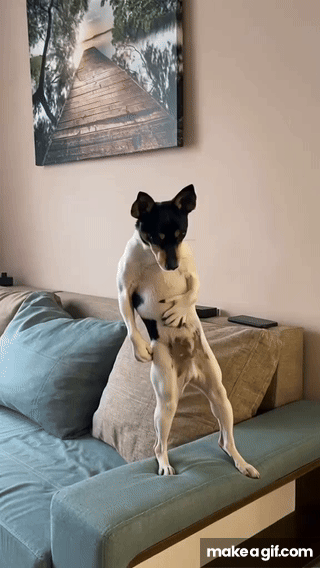

# 💀 WELCOME TO MY PROFILE

  
  

  

---

### 🚀 About Me

- 💻 Electrical & Computer Engineering Student at NTUA (ΕΜΠ)
- 🔒 Passionate about Hardware Security and hardware design
- ⚡ Working with Python, C, C++, VHDL, Assembly, and MATLAB
- 🐧 Learning Linux and Bash
- 🔭 Exploring embedded systems and low-level programming every day

---

### 🛠️ Tech Stack & Languages:

**Languages:**

  
  
  
  
  
  

**Hardware & Embedded Tools:**

  
  
  
  
  

**OS & Development Tools:**

  
  

---

### 📂 Featured Projects
Here are some of my key repositories:
- 🔌 **[Fir_Filter_VHDL](https://github.com/sotkoun/Fir_Filter_VHDL)** - FIR filter design implemented in VHDL.
- ⚡ **[Pipelined_Arithmetic_Units_VHDL](https://github.com/sotkoun/Pipelined_Arithmetic_Units_VHDL)** - Pipelined digital arithmetic units implementation.

---

### 📊 GitHub Stats & Metrics:

  
  

---

  
  

---

  <i>"Designing microcircuits to solve problems we wouldn't have, if we didn't have computers."</i>

